# DefectVision — Détection de défauts sur pièces de fonderie

Trois modèles pour dire si une pièce est **saine** ou **défectueuse** :

- **Supervisé** : ResNet-18 pré-entraîné, affiné sur des pièces saines et défectueuses.
- **Non supervisé** : autoencodeur entraîné **uniquement sur des pièces saines**. Une pièce qu'il reconstruit mal est suspecte.
- **Hybride** : régression logistique qui combine les deux scores.


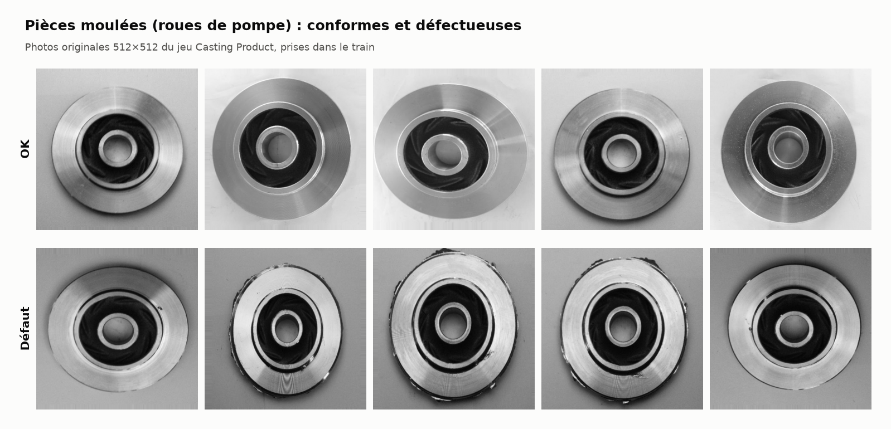

---

## Résultats

Blind test de **195 pièces jamais vues** (117 défauts). Seuils fixés sur la validation.

| Modèle | Rappel | Précision | Fausses alarmes | AUC ROC | Défauts manqués |
|---|---|---|---|---|---|
| Supervisé — ResNet-18 | 95,7 % | 99,1 % | 1,3 % | 0,998 | 5 |
| Autoencodeur | 95,7 % | 78,9 % | 38,5 % | 0,942 | 5 |
| **Hybride** | **97,4 %** | **99,1 %** | **1,3 %** | **0,999** | **3** |

### Courbes ROC et précision-rappel

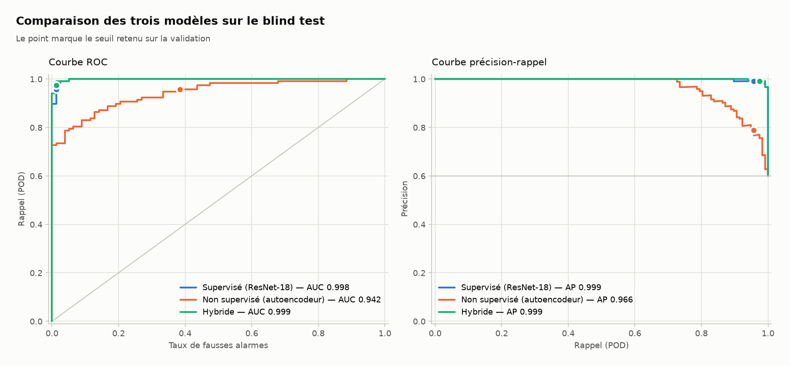

### Métriques avec intervalles de confiance (bootstrap, 2 000 tirages)

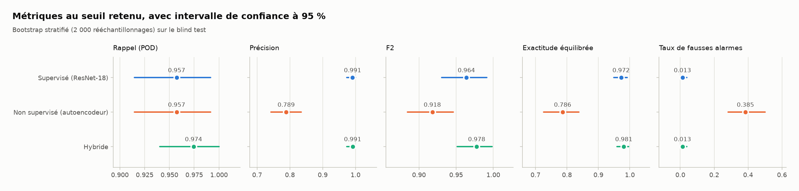

### Matrices de confusion

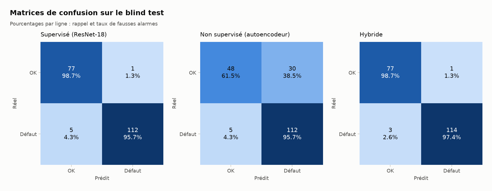

### Comment l'hybride combine les deux scores

Chaque point est une pièce. Axe horizontal : score du supervisé. Axe vertical : score de l'autoencodeur.

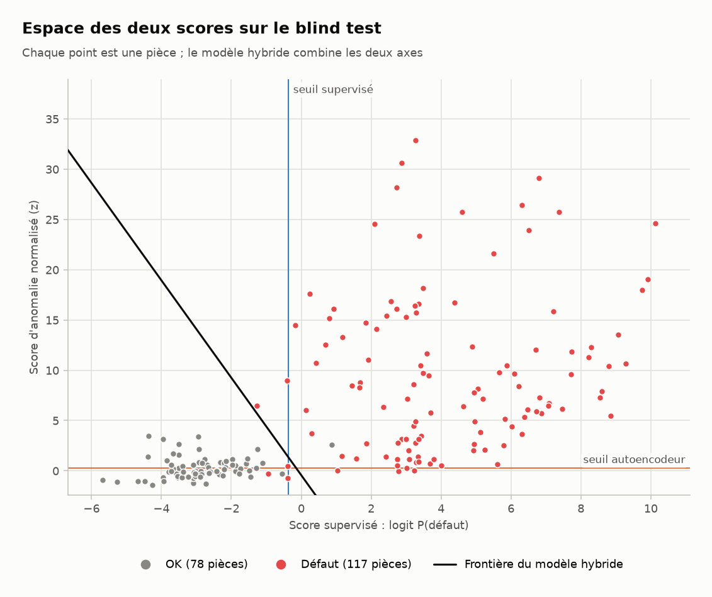

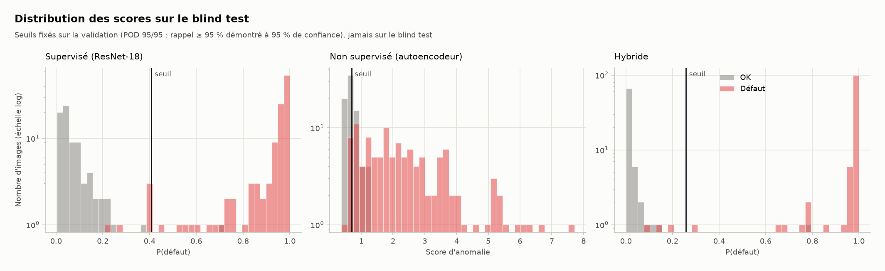

### Explicabilité

**Grad-CAM** (supervisé) : zones qui ont pesé dans la décision.

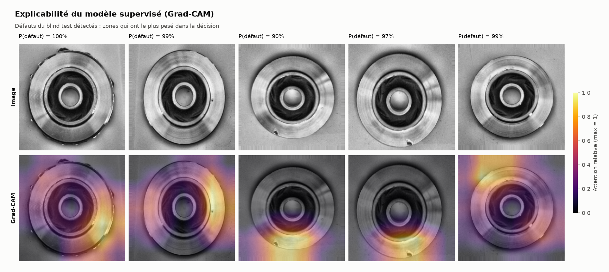

**Carte d'anomalie** (autoencodeur) : zones qui s'écartent d'une pièce saine.

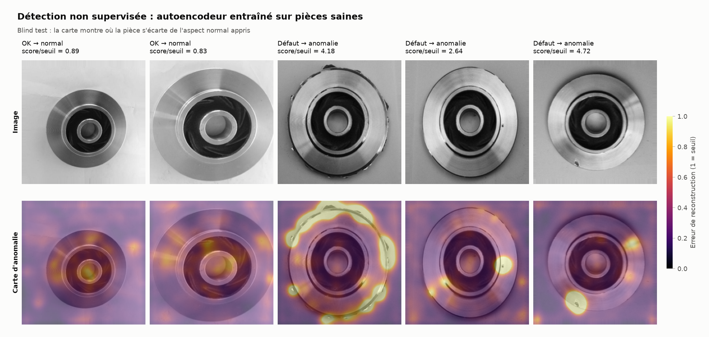

### Entraînement

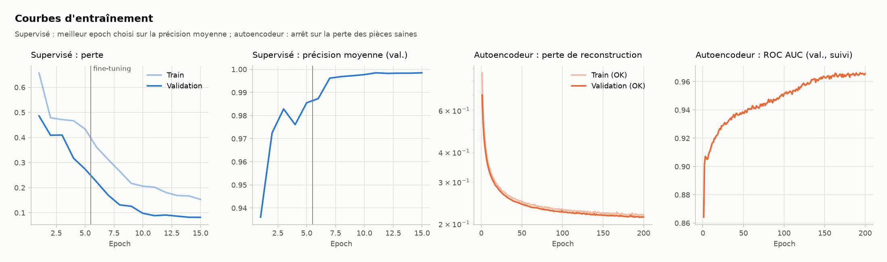

### Données

Découpage par groupes de photos d'une même pièce, sans fuite entre train, validation et blind test.

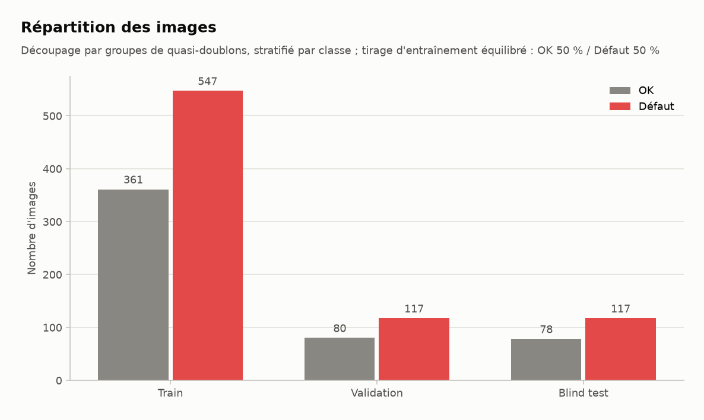

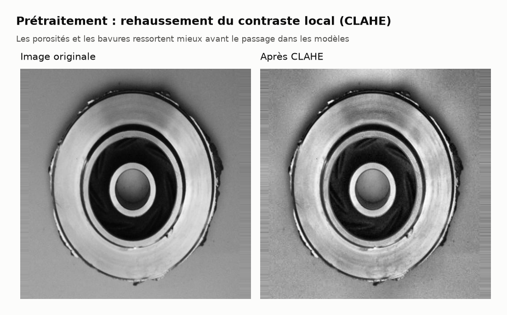

---

## MLOps

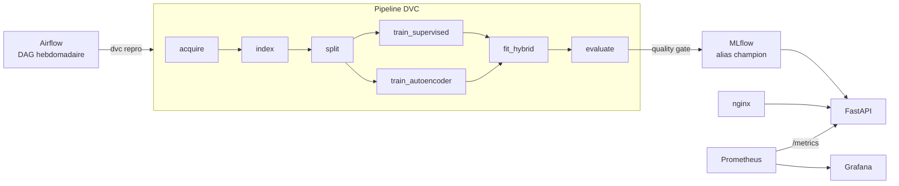

| Outil | Rôle |
|---|---|
| **DVC** | versionne données et modèles ; `dvc repro` ne relance que les étapes modifiées |
| **MLflow** | suivi des runs, registre des modèles (alias `champion` / `challenger`) |
| **Airflow** | réentraîne, évalue, vérifie la quality gate (rappel ≥ 95 %, précision ≥ 80 %), enregistre et recharge l'API |
| **FastAPI + nginx** | API de prédiction derrière une passerelle (limite de débit, taille max) |
| **Prometheus + Grafana** | latence, trafic, taux de défauts, dérive de luminosité et de contraste, alertes |
| **Docker Compose** | toute la pile en microservices |

### Grafana

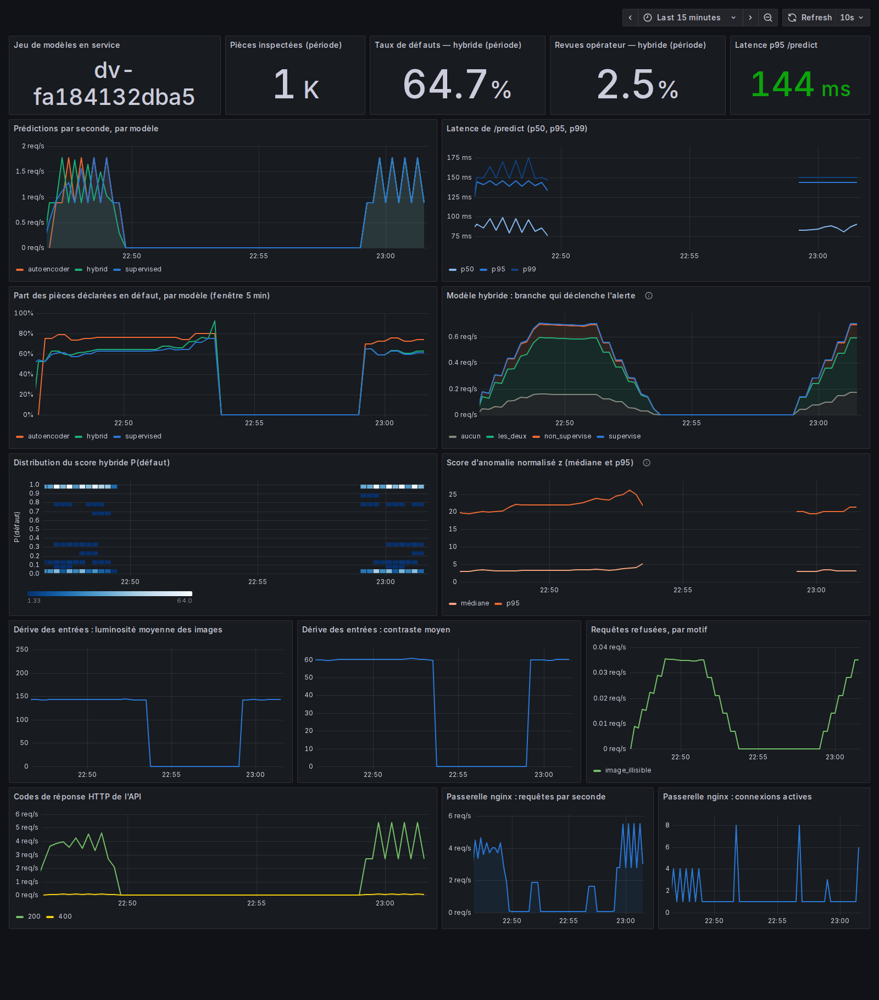

### Alertes Prometheus

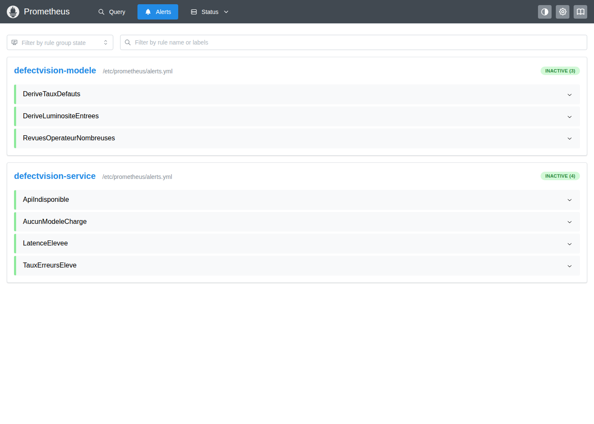

### MLflow

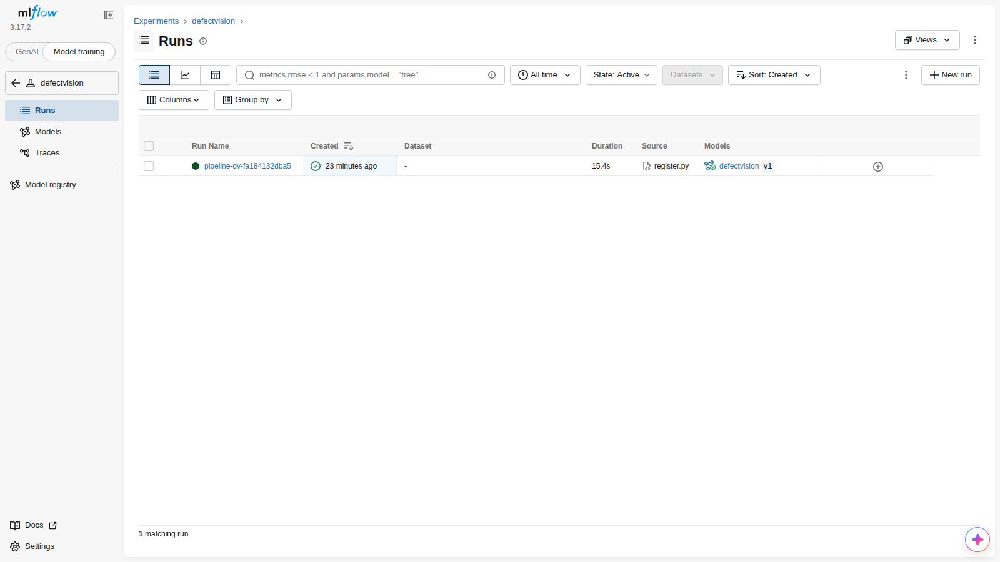

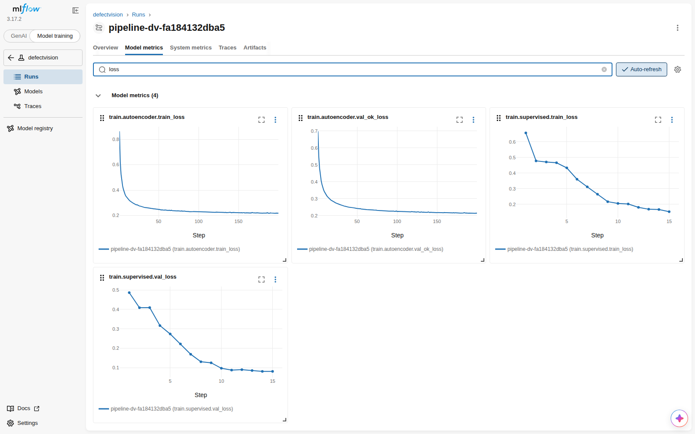

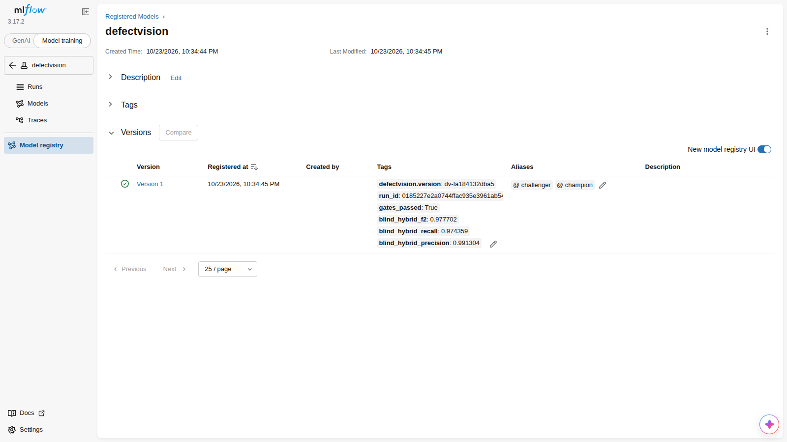

### Airflow

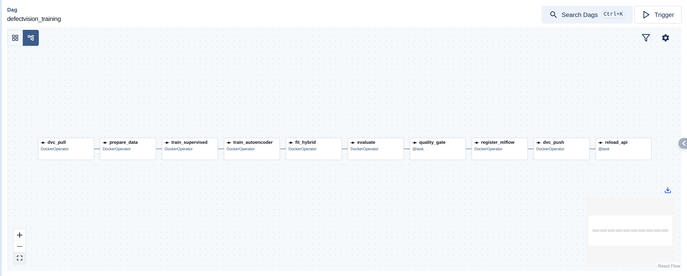

### API

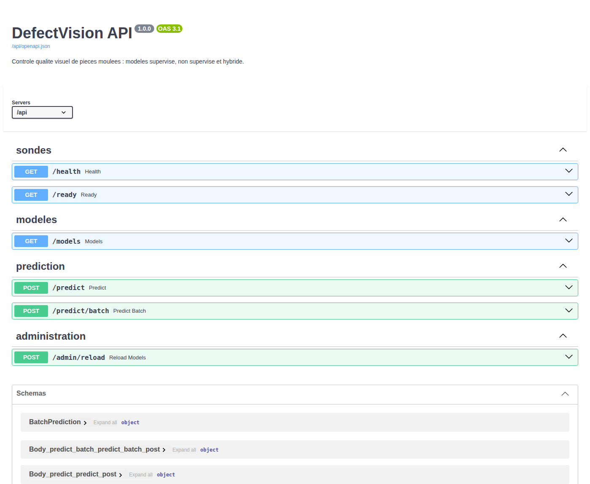

---

## Démarrage rapide

```bash
cp .env.example .env
docker compose build
docker compose --profile jobs build trainer
docker compose run --rm trainer dvc repro        # données + modèles + métriques
docker compose up -d
docker compose run --rm trainer python -m defectvision.registry.register --promote
```

```bash
curl -F "file=@piece.jpeg" "http://localhost:8088/api/predict?model=hybrid"
```

| Service | Adresse |
|---|---|
| API | http://localhost:8088/api/docs |
| Grafana | http://localhost:8088/grafana/ |
| MLflow | http://127.0.0.1:5500 |
| Airflow | http://127.0.0.1:8089 |

*Les choix détaillés sont dans [docs/DECISIONS.md](docs/DECISIONS.md).*
