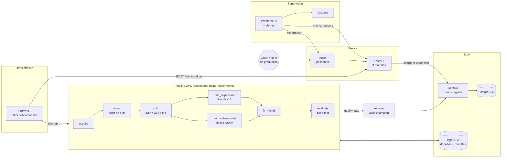

# DefectVision — Contrôle qualité industriel par vision

> Détection de défauts sur pièces de fonderie : un modèle **supervisé** (ResNet-18), un modèle **non supervisé**
> (autoencodeur entraîné sur pièces saines) et un modèle **hybride** qui combine les deux, industrialisés en
> microservices (Docker, Airflow, MLflow, DVC, FastAPI, nginx, Prometheus, Grafana).


---

## En bref

| Modèle (blind test, 195 pièces jamais vues) | Rappel (POD) | Précision | F2 | Fausses alarmes | AUC ROC |
|---|---|---|---|---|---|
| Supervisé — ResNet-18 | 95,7 % [91,5–99,1] | 99,1 % | 0,964 | 1,3 % | 0,998 |
| Non supervisé — autoencodeur | 95,7 % [91,5–99,1] | 78,9 % | 0,918 | 38,5 % | 0,942 |
| **Hybride — supervisé + non supervisé** | **97,4 % [94,0–100]** | **99,1 %** | **0,978** | **1,3 %** | **0,999** |

*Entre crochets : intervalle de confiance à 95 % (bootstrap stratifié, 2 000 rééchantillonnages). Seuils fixés sur la
validation, jamais sur le blind test.*

- **L'hybride rate 3 défauts sur 117, contre 5 pour chacun des deux autres**, sans fausse alarme de plus que le
  supervisé (1 sur 78 pièces saines). Il rattrape 2 des défauts manqués par le supervisé grâce à l'autoencodeur,
  et seules 3,1 % des pièces partent en revue opérateur.
- **Aucune fuite de données** : le découpage se fait par groupes de photos d'une même pièce. Le découpage fourni
  par Kaggle, lui, met des jumeaux exacts de part et d'autre (9 % des images de son test).
- **Tout est reproductible** : `dvc repro` reconstruit données, modèles, métriques et figures ; MLflow garde
  chaque run ; Airflow réentraîne, évalue, enregistre et redéploie.

---

## Le problème métier

Le contrôle qualité visuel en industrie (aéronautique, automobile, métallurgie) repose sur des opérateurs dont
la vigilance chute après deux heures d'inspection continue. Le taux de défauts non détectés varie de 5 à 15 %
selon la fatigue. Un défaut non détecté en aéronautique peut coûter des vies ; un rappel produit coûte **100 à
1 000 fois** plus cher qu'une détection en ligne.

## La solution : trois modèles complémentaires

Un système d'**assistance à l'opérateur** (pas de remplacement), construit selon la démarche décrite dans l'article
[« Anomaly detection non supervisée vs détection de défauts supervisée »](https://infoscribe.ai/anomaly-detection-non-supervisee-vs-detection-de-defauts-supervisee/) :

| | Supervisé | Non supervisé | Hybride |
|---|---|---|---|
| Modèle | ResNet-18 (transfert d'apprentissage) | Autoencodeur de caractéristiques | Régression logistique sur les deux scores |
| Apprend sur | pièces OK **et** défectueuses | pièces **saines uniquement** | scores de validation |
| Point fort | précision sur les défauts connus | détecte l'inattendu (défaut jamais vu) | la précision du premier, la couverture du second |
| Explication | Grad-CAM | carte d'erreur de reconstruction | branche déclenchante + revue opérateur |

Le modèle hybride indique pour chaque pièce **quelle branche** a déclenché l'alerte (`supervise`, `non_supervise`,
`les_deux`) et demande une **revue opérateur** lorsqu'une anomalie forte n'est vue que par l'autoencodeur (défaut
peut-être d'un type nouveau) ou lorsque la décision est proche du seuil.

---

## Résultats

### Comparaison sur le blind test


### Comment l'hybride combine les deux scores

Chaque point est une pièce du blind test. Le supervisé sépare déjà très bien les classes (axe horizontal) ;
l'autoencodeur (axe vertical) fait remonter des défauts que le supervisé juge peu probables. La frontière du
modèle hybride exploite les deux axes.


Ce que l'autoencodeur apporte, sur les 117 défauts du blind test : le supervisé en manque 5. L'autoencodeur en
signale 3 : l'hybride en retient 2 et envoie le troisième en revue opérateur. Il en reste 2 que ni l'un ni
l'autre ne voit. Côté pièces saines, l'autoencodeur seul en signale 29 à tort : l'hybride n'en retient aucune et
n'en renvoie que 3 en revue.

### Seuils : une POD 95/95

En contrôle non destructif, une probabilité de détection se **démontre** : le seuil de chaque modèle est celui qui
maximise la précision tout en garantissant, sur la validation, un rappel d'au moins 95 % **avec 95 % de confiance**
(borne inférieure de Clopper-Pearson, dans l'esprit du critère a90/95 de la MIL-HDBK-1823A).

> **Transparence.** Cette règle a remplacé la règle du notebook d'origine (« rappel observé ≥ 95 % ») après une
> première évaluation sur le blind test, où les trois modèles restaient sous 95 % de rappel (0,932 / 0,897 / 0,923).
> Seuls les seuils ont changé (mêmes données, mêmes poids). Les deux évaluations sont conservées
> (`reports/experiments/`) et le raisonnement est détaillé dans [docs/DECISIONS.md](docs/DECISIONS.md).

### Temps d'inférence (CPU)

| Modèle | Médiane par image | 95e centile |
|---|---|---|
| Supervisé | 63 ms | 70 ms |
| Autoencodeur | 110 ms | 114 ms |
| Hybride (les deux) | 169 ms | 177 ms |

*Mesuré par l'étape `evaluate` (30 images du blind test, 4 threads CPU, prétraitement compris) sur un serveur
Linux ; le temps réseau et le passage par nginx s'y ajoutent en service.*

---

## Données : un découpage sans fuite

**Jeu** : [Casting Product Image Data](https://www.kaggle.com/datasets/ravirajsinh45/real-life-industrial-dataset-of-casting-product)
(roues de pompe submersible). Il contient 1 300 photos originales 512×512 (519 OK, 781 défauts) et 7 348 images
300×300 que l'auteur a déjà augmentées à partir de ces mêmes photos.

**Audit de fuite** (étape `index`, `reports/data_audit.json`) : chaque image reçoit une empreinte perceptuelle
(dHash 256 bits, sous les 8 symétries du carré). Dans le découpage train/test fourni par Kaggle, **9,0 % des
images de test ont un jumeau exact dans le train** et 33,7 % un quasi-doublon : un score mesuré dessus est
optimiste.

**Découpage du projet** :
- on part des 1 300 originaux et on regroupe les photos d'une même pièce : lien sûr si la distance dHash est
  ≤ 12 bits, lien vérifié si elle est ≤ 20 bits **et** que la corrélation du détail fin (grain de fonderie) est
  ≥ 0,5. Résultat : 1 039 groupes ;
- découpage **par groupe** et **stratifié par classe** : train 70 %, validation 15 %, blind test 15 % ;
- le **blind test est figé** : il ne dépend que d'un sel et de son ratio, et changer un autre réglage ne le
  modifie pas ;
- des contrôles automatiques vérifient qu'aucun groupe ni aucun fichier n'est partagé entre deux jeux.


**Train insensible au déséquilibre** : le jeu compte 60 % de défauts. Le train porte un poids par image (inverse
de la fréquence de sa classe) et l'entraînement supervisé tire ses lots avec `WeightedRandomSampler` : **chaque
lot est en moyenne à 50/50**. Les métriques suivies sont insensibles à la prévalence (rappel, précision, F2,
exactitude équilibrée, MCC, AUC, précision moyenne).

**Prétraitement** : CLAHE (rehaussement du contraste local) pour le modèle supervisé. L'autoencodeur, lui,
fonctionne mieux **sans** CLAHE : le rehaussement amplifie la texture normale de la fonte, qu'il prend alors pour
une anomalie (AUC de validation 0,87 → 0,95).


---

## Explicabilité

**Grad-CAM** (modèle supervisé) : les zones qui ont le plus pesé dans la décision.


**Carte d'anomalie** (autoencodeur) : là où la pièce s'écarte de l'aspect normal appris. L'échelle est absolue :
1 correspond au seuil de décision.


## Entraînement


- **Supervisé** : ResNet-18 pré-entraîné sur ImageNet. Phase 1 (tête seule, lr 1e-3, 5 epochs), puis phase 2
  (deux derniers blocs dégelés, lr 1e-5, 10 epochs, décroissance cosinus). Le meilleur epoch est choisi sur la
  précision moyenne de validation.
- **Autoencodeur** : il reconstruit, par des convolutions 1×1, les caractéristiques des couches 2 et 3 d'un
  ResNet-18 gelé (320 px, espace latent de 32 canaux, 200 epochs) ; seules les 361 pièces saines du train servent
  à l'entraînement. Ces réglages ont été choisis parmi 11 variantes, **sur la validation uniquement**
  ([tableau](docs/DECISIONS.md#m3-non-supervisé--autoencodeur-de-caractéristiques-entraîné-sur-les-seules-pièces-saines)).
  Une variante sur pixels (perte L2 + SSIM) est disponible.
- **Hybride** : régression logistique à classes équilibrées sur `logit(p_supervisé)` et le score d'anomalie
  normalisé. Le seuil est choisi sur des prédictions hors échantillon (validation croisée à 5 plis).

Campagne du 23/10/2026 sur un GPU NVIDIA L4 (RunPod) : le pipeline complet tourne en **moins de 5 minutes**.

---

## Architecture MLOps



| Service | Image | Rôle | Accès |
|---|---|---|---|
| `nginx` | nginx 1.27 | passerelle unique, limite de débit sur `/api/predict`, 10 Mo max | http://localhost:8088 |
| `api` | `defectvision-api` | FastAPI : prédiction, explications, métriques | via nginx `/api/` |
| `mlflow` | `defectvision-mlflow` | suivi des runs, registre des modèles | http://127.0.0.1:5500 |
| `postgres` | postgres 16 | métadonnées MLflow et Airflow | interne |
| `prometheus` | prom 3.5 | collecte des métriques, règles d'alerte | http://127.0.0.1:9091 |
| `grafana` | grafana 12.1 | tableau de bord provisionné | http://localhost:8088/grafana/ |
| `nginx-exporter` | exporter 1.4 | métriques nginx | interne |
| `airflow-*` | airflow 3.2.1 | orchestration (profil `airflow`) | http://127.0.0.1:8089 |
| `trainer` | `defectvision-trainer` | tâches du pipeline (profil `jobs`) | — |

### Interfaces

> Captures prises pendant une démonstration de bout en bout sur un serveur Linux de test : **même code, mêmes
> fichiers de configuration** (`nginx.conf`, `prometheus.yml`, `alerts.yml`, provisionnement et tableau Grafana,
> DAG), services lancés en processus plutôt qu'en conteneurs, et trafic réel : deux séries de 720 prédictions
> sur des images du blind test, envoyées à travers nginx par `scripts/smoke_test.py`.

**Supervision Grafana** : trafic par modèle, latence, part des pièces déclarées en défaut, branche déclenchante
de l'hybride, distribution des scores, score d'anomalie, dérive de la luminosité et du contraste des images,
requêtes refusées (fichiers invalides envoyés exprès), codes HTTP, passerelle nginx.


**Règles d'alerte Prometheus** (toutes inactives : le service est sain).


**MLflow** : le run du pipeline, ses historiques par epoch, et le registre avec les alias `champion` et
`challenger`.


**Airflow 3.2** : le DAG `defectvision_training`.


**API** : documentation interactive servie derrière nginx.


---

## Structure du projet

```
DefectVision/
├── README.md
├── params.yaml                 # tous les hyperparamètres (suivis par DVC)
├── dvc.yaml / dvc.lock         # pipeline et empreintes des données, modèles, métriques
├── docker-compose.yml          # pile de microservices (profils airflow, jobs)
├── .env.example                # variables à copier en .env
├── pyproject.toml              # paquet, pytest, ruff
├── requirements/               # dépendances épinglées, une liste par image
├── src/defectvision/
│   ├── data/                   # acquisition, hachage perceptuel, index, découpage, augmentations, jeux PyTorch
│   ├── models/                 # classifier.py (ResNet-18), autoencoder.py, hybrid.py
│   ├── training/               # train_supervised.py, train_autoencoder.py, fit_hybrid.py
│   ├── evaluation/             # métriques, POD 95/95, bootstrap, évaluation du blind test, figures
│   ├── inference/              # chargement des modèles, scores, prédicteur unique (API + MLflow)
│   ├── explain/                # Grad-CAM, superposition des cartes
│   ├── registry/               # enregistrement MLflow, modèle pyfunc
│   └── serving/                # API FastAPI, métriques Prometheus, rechargement à chaud
├── airflow/dags/               # DAG defectvision_training
├── scripts/smoke_test.py       # test de fumée de la pile déployée (envoie des images à l'API)
├── docker/                     # Dockerfiles (api, trainer, mlflow), nginx, prometheus, grafana, postgres
├── tests/                      # 54 tests : données, métriques, modèles, pipeline, API, registre, DAG
├── data/                       # raw / interim / splits (gérés par DVC, hors git)
├── models/                     # supervised / autoencoder / hybrid + manifest.json (DVC)
├── reports/                    # métriques, historiques, prédictions, figures (versionnés par git)
├── docs/                       # DECISIONS.md, images du README
└── notebooks/                  # notebook Colab d'origine (conservé pour l'historique)
```

---

## Démarrage rapide

### Prérequis

Docker et Docker Compose. Si un antivirus ou un proxy inspecte le HTTPS du poste, déposez son certificat racine
public dans `docker/certs/` (voir [docker/certs/README.md](docker/certs/README.md)).

### 1. Configuration

```bash
cp .env.example .env        # puis remplacer chaque "change-me"
docker compose build        # images api et mlflow
docker compose --profile jobs build trainer
```

### 2. Données et modèles (DVC)

```bash
# Récupère données et modèles depuis le dépôt DVC (dossier dvcstore/)...
docker compose run --rm trainer dvc pull
# ...ou reconstruit tout depuis Kaggle (téléchargement public de ~105 Mo ; moins de 5 min sur un GPU L4)
docker compose run --rm trainer dvc repro
```

> Sous Windows (Docker Desktop), le montage du dépôt est lent pour les milliers de petits fichiers d'images :
> `dvc pull` peut prendre une demi-heure. Les empreintes déjà calculées sont gardées dans un volume Docker,
> si bien que les exécutions suivantes sont rapides (voir [docs/DECISIONS.md](docs/DECISIONS.md), I9).

### 3. Service et supervision

```bash
docker compose up -d
docker compose run --rm trainer python -m defectvision.registry.register --promote   # premier champion MLflow
```

Puis :
- page d'accueil : http://localhost:8088
- documentation interactive de l'API : http://localhost:8088/api/docs
- Grafana : http://localhost:8088/grafana/
- MLflow : http://127.0.0.1:5500

### 4. Orchestration Airflow (optionnel)

```bash
# DEFECTVISION_HOST_PROJECT_DIR doit pointer vers ce dépôt tel que le voit le démon Docker
docker compose --profile airflow up -d
```

Le DAG `defectvision_training` (hebdomadaire, en pause à la création) enchaîne : `dvc pull` → préparation des
données → deux entraînements → hybride → évaluation → **quality gate** → enregistrement MLflow → `dvc push` →
rechargement de l'API. Chaque étape tourne dans un conteneur `trainer` éphémère. `dvc repro` ne refait que ce
qui a changé : sans changement, le DAG passe en quelques secondes.

---

## Utiliser l'API

```bash
curl -F "file=@piece.jpeg" "http://localhost:8088/api/predict?model=hybrid"
```

```json
{
  "filename": "piece.jpeg",
  "model": "hybrid",
  "label": "DEFAUT",
  "is_defect": true,
  "score": 0.99999,
  "threshold": 0.2573,
  "review_required": false,
  "details": {"p_supervised": 0.9988, "anomaly_score": 1.216, "anomaly_z": 8.17, "source": "les_deux"},
  "model_version": "dv-…",
  "inference_ms": 160.4
}
```

| Point d'entrée | Rôle |
|---|---|
| `POST /predict?model=supervised\|autoencoder\|hybrid&explain=true` | une image ; `explain` ajoute les cartes Grad-CAM et d'anomalie (PNG base64) |
| `POST /predict/batch` | jusqu'à 16 images |
| `GET /models` | version servie, seuils, métriques |
| `GET /health`, `GET /ready` | sondes de vie et de disponibilité |
| `GET /metrics` | métriques Prometheus |
| `POST /admin/reload` | recharge le champion MLflow (jeton `X-Admin-Token`, non exposé par nginx) |

## Supervision

Métriques exposées : requêtes et latences, prédictions par modèle et par classe, distribution des scores, score
d'anomalie normalisé, revues opérateur, branche déclenchante du modèle hybride, **luminosité et contraste des
images reçues** (dérive de l'éclairage ou de la caméra), refus par motif.

Règles d'alerte Prometheus : API muette, aucun modèle chargé, latence p95 > 1 s, plus de 5 % d'erreurs, taux de
défauts ou luminosité s'écartant de la moyenne sur 7 jours, plus de 30 % de revues opérateur.

---

## Pipeline DVC

```bash
dvc dag                    # graphe des étapes
dvc repro                  # ne relance que ce qui a changé
dvc metrics show           # métriques de validation et du blind test
dvc params diff            # paramètres modifiés depuis le dernier commit
dvc plots show             # courbes d'entraînement
dvc push / dvc pull        # synchronisation avec le dépôt DVC (dvcstore/ par défaut)
```

| Étape | Produit |
|---|---|
| `acquire` | `data/raw/casting` (archive Kaggle vérifiée par SHA-256) |
| `index` | `data/interim/index.csv`, `reports/data_audit.json` |
| `split` | `data/splits/{train,val,blind_test}.csv`, `reports/split_report.json` |
| `train_supervised` | `models/supervised/`, historique, métriques de validation |
| `train_autoencoder` | `models/autoencoder/`, historique, métriques de validation |
| `fit_hybrid` | `models/hybrid/hybrid.json`, comparaison stacking / règle OU |
| `evaluate` | `reports/metrics/blind_test.json`, prédictions, `models/manifest.json`, figures |

## Tests et qualité

```bash
docker compose run --rm trainer sh -c "pip install -q -r requirements/serve.txt pytest==8.4.2 httpx ruff==0.17.2 && pytest -q && ruff check src tests airflow"
```

54 tests : hachage invariant aux symétries, découpage sans fuite et blind test figé, choix des seuils comparé à
une recherche exhaustive, règle POD 95/95, modèles, pipeline complet sur un jeu synthétique, API (sondes, erreurs,
métriques Prometheus, jeton d'administration), enregistrement et chargement MLflow, structure du DAG Airflow.

## Concepts clés

| Terme IA | Terme CND | Signification |
|---|---|---|
| Rappel (recall) | POD (Probability of Detection) | part des défauts réels détectés |
| Borne inférieure du rappel à 95 % | POD 95/95 | rappel démontré avec 95 % de confiance |
| Faux négatif | Défaut non détecté | risque critique |
| Faux positif | Fausse alarme | coût de re-inspection |
| F2 | — | moyenne harmonique qui donne deux fois plus de poids au rappel |

## Limites et pistes

- **Un seul type de pièce et une seule caméra** : avant de passer à une autre référence, il faut recalibrer les
  seuils, et réentraîner l'autoencodeur sur des pièces saines de cette référence.
- **Pas de localisation annotée** : le jeu n'a que des étiquettes d'image. Un détecteur (YOLOX) ou une
  segmentation (U-Net) demanderaient des boîtes ou des masques.
- **Blind test de 195 pièces** : les intervalles de confiance restent larges (± 4 points de rappel). Comme il a
  servi deux fois (voir plus haut), il faut le renouveler avec des pièces nouvelles.
- Pistes : PatchCore comme second détecteur non supervisé, export ONNX pour une caméra embarquée, renouvellement
  automatique du blind test à partir des pièces revues par les opérateurs.

## Auteur

Projet réalisé dans le cadre d'un portfolio Data Science / IA industrielle.
Profil : Docteur-Ingénieur, expertise CND et capteurs, reconversion IA.

---

*Les choix et leurs justifications sont détaillés dans [docs/DECISIONS.md](docs/DECISIONS.md).*
